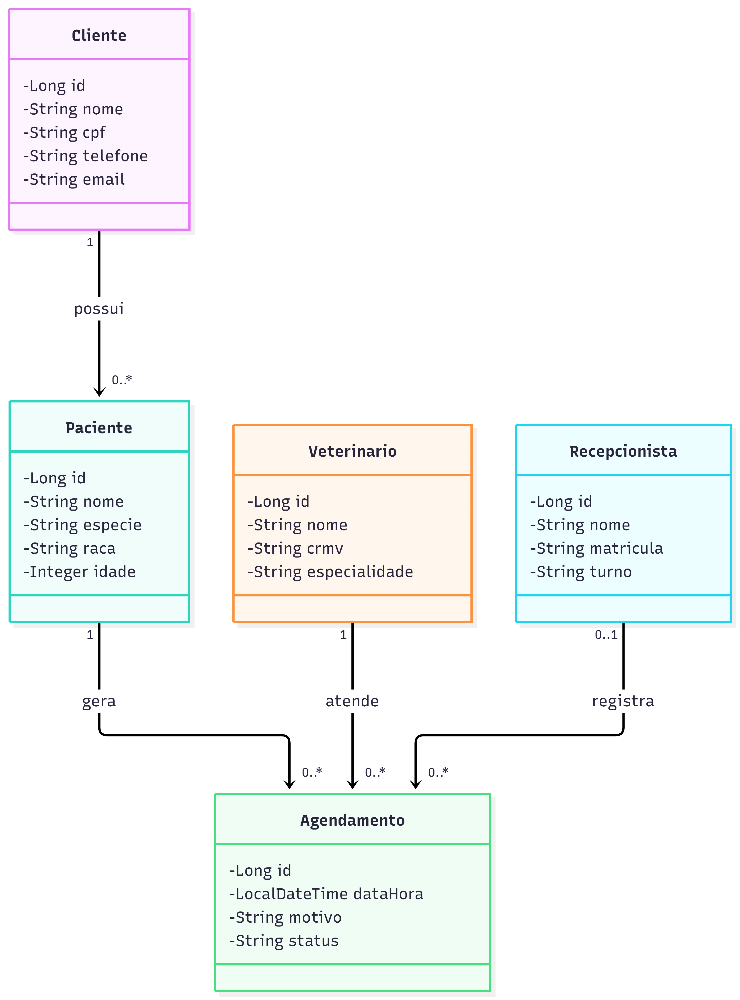

# PROJETO INTEGRADOR — Sistema de Gestão de Clínica Veterinária

Sistema web desenvolvido para o gerenciamento de rotinas e agendamentos de uma clínica veterinária, composto por API REST em Java/Spring Boot, interface SPA em Angular e banco de dados relacional MySQL hospedados na nuvem.

## 👥 Integrantes do Grupo
- **Francisco Javier Gomez Cervantes** — RA: 273036
- **Álvaro Henrique de Moraes Cruz** — RA: 273732
- **Guilherme dos Santos Alves** — RA: 273305
- **João Pedro Veiga Manosso** — RA: 273724
- **Rafael Rosa Vieira** — RA: 273746

## 🚀 Acesso à Aplicação em Produção
- **Aplicação Web (Frontend):** `https://vet-frontend-production-42ae4d3a.up.railway.app`
- **API Backend:** `https://sistema-de-veterinaria-production.up.railway.app`
- **Repositório Git:** `https://github.com/Tatzel1223/Sistema-de-veterinaria`

## 🛠️ Tecnologias Utilizadas
- **Backend:** Java, Spring Boot, Spring Data JPA, Spring Security (HTTP Basic com roles `ADMIN` e `USER`)
- **Frontend:** Angular, Angular Material
- **Banco de Dados:** MySQL
- **Infraestrutura / Deploy:** Railway

## 📦 Entidades do Domínio e Regras de Negócio

### Entidades Principais
- **Cliente:** Representa o tutor/responsável pelo animal e possui fluxo funcional na aplicação.
- **Veterinario:** Representa o profissional responsável pelos atendimentos e possui fluxo funcional na aplicação.
- **Paciente:** Representa o animal atendido pela clínica, presente no modelo de domínio/diagrama.
- **Recepcionista:** Representa o perfil de recepção/atendimento no modelo de domínio/diagrama.
- **Agendamento:** Representa os atendimentos marcados relacionando paciente, veterinário e horário no modelo de domínio.

### Estado Atual das Funcionalidades
- **Fluxos ativos na aplicação:** Cadastro e gerenciamento de **Clientes** e **Veterinários**.
- **Demais entidades e regras:** Presentes na modelagem do sistema/diagrama de classes, com implementação/integração em andamento ou parcial no estado atual da entrega.
- **Segurança e Acesso:** Autenticação configurada com perfis (`ADMIN` / `USER`).

## 📐 Diagrama de Classes


## 💻 Como Executar Localmente
1. **Clone o repositório:**
   ```bash
   git clone [https://github.com/Tatzel1223/Sistema-de-veterinaria.git](https://github.com/Tatzel1223/Sistema-de-veterinaria.git)
